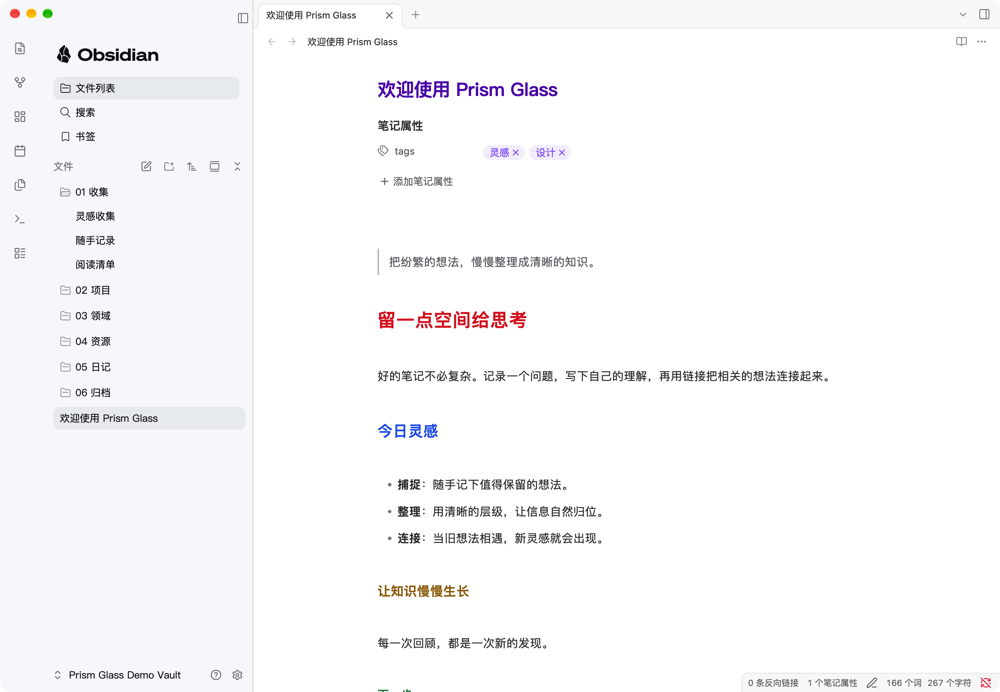

# Prism Glass

Prism Glass is an Obsidian desktop theme inspired by the sidebar of DeepSeek Harness. It combines a glass-inspired sidebar and vertical navigation with colorful editor headings and comfortable note typography, while keeping Obsidian's built-in styling as the base.

The screenshot shows the theme in a separate demo vault with example notes and no companion plugin.

## Installation

1. Copy `manifest.json` and `theme.css` into your vault's `.obsidian/themes/Prism Glass/` folder.
2. Open **Settings → Appearance → Themes** in Obsidian and select **Prism Glass**.

The theme includes its note typography; no Quiet Notes snippet or companion plugin is required. Create a note with Obsidian's normal new-note control in the file explorer or its keyboard shortcut.

## Compatibility

The current version requires Obsidian 1.15.0 or newer and has been tested on macOS. Other platforms have not yet been verified. On macOS, the main left sidebar uses a solid background when window translucency is enabled to avoid view-switching ghosting; surrounding areas may still use the native translucent material. Fonts fall back to those available on the device, so text metrics can differ between systems. Long file names can reveal their ends on hover on supported desktop devices. Mobile and other desktop platforms have not been verified.

## Credits

Some sidebar assets and visual details are derived from [DeepSeek Harness](https://github.com/deepseek-ai/deepseek-harness), distributed under the MIT license. See [its license](third-party/DeepSeek-Harness-LICENSE). The sidebar uses Obsidian's [official single-color logo lockup](https://obsidian.md/brand); Obsidian names and marks belong to their respective owner. This independent project is not affiliated with or endorsed by Obsidian.

Note typography and table styles incorporate [Quiet Notes for Obsidian](https://github.com/andrewchen0623/obsidian-quiet-notes) by Andrew, distributed under the MIT license. See [its license](third-party/Quiet-Notes-LICENSE); the notice is also included in `theme.css`.
